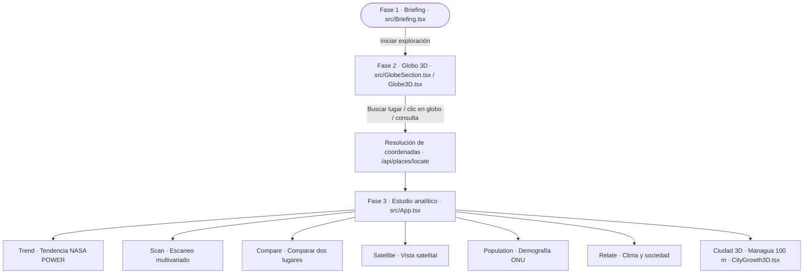
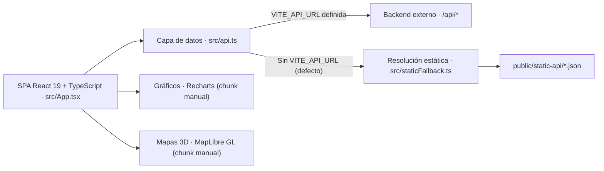

<a id="inicio"></a>

# DATEX — Especificación técnica del proyecto

<p align="center"></p>

**Boreal Labs · NASA Space Apps Challenge 2026**

**Web publicada:** [jamesjsfouam.github.io/Datexv2](https://jamesjsfouam.github.io/Datexv2/) · **Repositorio:** [GitHub · Datexv2](https://github.com/jamesjsfouam/Datexv2) · **Licencia:** [MIT](LICENSE)

**Estado:** aplicación web estática operativa en producción (`dist/` desplegable sin backend obligatorio), con modo de datos precalculados en `public/static-api/` y soporte opcional para API externa vía `VITE_API_URL`.

[Índice](#indice) · [Experiencia y vistas](#flujo) · [Datos y arquitectura](#arquitectura) · [Stack técnico](#stack) · [Ejecutar la app](#instalacion)

**DATEX** responde a una pregunta concreta: *¿el clima está cambiando de verdad?* La plataforma separa la tendencia climática real de las variaciones estacionales o falsas alarmas utilizando más de 40 años de datos satelitales y reanálisis de la NASA (1981–presente), combinados con series demográficas de la ONU, indicadores del Banco Mundial y un escenario 3D de crecimiento urbano por celdas de 100 m para Managua.

Este README es el documento principal de especificación técnica del repositorio. Describe el propósito del proyecto, el recorrido de la interfaz, las fuentes de datos, la arquitectura del frontend, los comandos de desarrollo y verificación, y las condiciones de despliegue.

<a id="indice"></a>

## Índice de lectura

| Área | Qué encontrarás | Accesos directos |
| --- | --- | --- |
| **01 · Proyecto** | Problema, alcance, capacidades y límites | [Propósito y alcance](#problema) · [Capacidades](#capacidades) · [Identidad y activos](#identidad) |
| **02 · Experiencia** | Recorrido en tres fases, globo 3D y estudio analítico | [Flujo de usuario](#flujo) · [Pestañas del estudio](#vistas) · [Escenario Ciudad 3D](#ciudad3d) |
| **03 · Datos y arquitectura** | Fuentes científicas, modo estático y componentes | [Arquitectura](#arquitectura) · [Fuentes de datos](#fuentes) · [Static API y fallback](#static-api) |
| **04 · Desarrollo técnico** | Stack, estructura de archivos, comandos y configuración | [Stack técnico](#stack) · [Organización del código](#estructura) · [Instalación y scripts](#instalacion) · [Despliegue](#despliegue) |
| **05 · Créditos y licencia** | Base del proyecto, atribución de datos y licencia | [Créditos](#creditos) · [Licencia](#licencia) |

**Para desarrollar:** empieza por [stack técnico](#stack), [organización del código](#estructura) e [instalación y scripts](#instalacion). **Para comprender el proyecto:** sigue [propósito](#problema) → [flujo de usuario](#flujo) → [arquitectura](#arquitectura).

<details>
<summary><strong>Cómo leer este documento y el estado del código</strong></summary>

- **Implementado:** presente y verificable en el código fuente actual (`src/`, `public/static-api/`, `.github/workflows/deploy.yml`).
- **Modo estático por defecto:** sin configurar `VITE_API_URL`, la app funciona de forma autónoma consumiendo los JSON precalculados en `public/static-api/`.
- **Backend opcional:** cuando se define `VITE_API_URL`, el cliente consulta endpoints `/api/*` (por ejemplo `/api/weather` para clima actual o consultas dinámicas).
- **Escenario vs. predicción:** la vista **Ciudad 3D** (Managua) modela un escenario paramétrico por celdas de 100 m; **no** constituye un pronóstico determinista.

</details>

<a id="proyecto"></a>

# I. Proyecto y problemática

Contexto climático, propósito científico-divulgativo y límites explícitos de la plataforma.

<a id="problema"></a>

## 1. Problema, propósito y alcance

Interpretar el cambio climático a escala local suele verse distorsionado por eventos meteorológicos puntuales o variabilidad estacional. DATEX busca ofrecer un **veredicto honesto de tendencia** para cualquier coordenada del planeta, contrastando series mensuales de largo plazo con métricas estadísticas claras y visualizaciones comparativas.

El proyecto comprende cuatro pilares funcionales:

1. **Briefing de entrada:** introducción visual en pantalla completa que contextualiza la pregunta central y prepara la transición al globo interactivo.
2. **Globo 3D interactivo (`Globe3D`):** exploración planetaria con selección directa de coordenadas, búsqueda de lugares, consulta en lenguaje natural (`ask`) y selección guiada por preocupación climática y tipo de lugar.
3. **Estudio analítico (`Studio`):** seis pestañas especializadas para inspeccionar tendencia histórica, escaneo multivariado, comparación entre dos puntos, imágenes satelitales, demografía ONU frente al ritmo lineal y relación clima–sociedad.
4. **Escenario urbano 3D (`CityGrowth3D`):** simulación espacial por celdas de 100 m sobre **Managua, Nicaragua**, vinculando crecimiento urbano con población, ingreso y clima.

### Límites

- El modo predeterminado trabaja sobre un conjunto precalculado en `public/static-api/`; las consultas de clima en tiempo real (`/api/weather`) requieren un backend configurado mediante `VITE_API_URL`.
- Los datos completos del Banco Mundial incluidos de forma estática cubren **Nicaragua, México, Brasil y Argelia**.
- El repositorio no incluye archivo `.env.example` ni servidor backend; corresponde únicamente al cliente web SPA y sus activos estáticos.
- El escenario urbano 3D de Managua es exploratorio y no sustituye estudios oficiales de ordenamiento territorial o proyecciones demográficas oficiales.

[↑ Volver al índice](#indice)

<a id="capacidades"></a>

## 2. Capacidades principales

| Capacidad | Descripción verificada en código | Alcance actual |
| --- | --- | --- |
| Tendencia climática | 17 variables mensuales NASA POWER desde 1981 (`TrendView`, `TrendChart`) | Global sobre puntos del catálogo y coordenadas resueltas |
| Escaneo de variables | Revisión transversal de indicadores para el punto seleccionado (`ScanView`) | Completo en modo estático y backend |
| Comparación espacial | Contraste directo entre dos ubicaciones (`ComparePlaces`) | Selección desde búsqueda o clic en el globo |
| Imágenes satelitales | Consulta de capas e historial satelital (`SatelliteView`) | Integración visual en la pestaña `satellite` |
| Población y ritmo lineal | Series ONU frente a crecimiento lineal (`DemographyView`) | Datos World Population Prospects vía OWID |
| Relación clima–sociedad | Cruce de variables climáticas e indicadores socioeconómicos (`RelateView`) | Completo para Nicaragua, México, Brasil y Argelia |
| Ciudad 3D (Managua) | Escenario de expansión por celdas de 100 m con `maplibre-gl` (`CityGrowth3D`) | Escenario `managua.json` (`12.13, -86.25`) |
| Bilingüe ES / EN | Diccionario completo de interfaz y textos explicativos (`src/i18n.ts`) | Cambio dinámico de idioma |

[↑ Volver al índice](#indice)

<a id="identidad"></a>

## 3. Identidad visual y activos

| Elemento | Especificación en el repositorio |
| --- | --- |
| Marca | **DATEX** · desarrollado por **Boreal Labs** |
| Activos gráficos | `public/logo.png`, `public/boreal-labs.png`, `public/favicon.png`, `public/shard-{top,bottom,left,right}.png` |
| Tipografía | **Satoshi** cargada desde Fontshare en `index.html` |
| Transiciones | `document.startViewTransition` en cambios de fase (`withTransition` en `src/App.tsx`) |

[↑ Volver al índice](#indice)

<a id="experiencia"></a>

# II. Experiencia y análisis

Recorrido de usuario en tres fases y módulos analíticos disponibles en la interfaz.

<a id="flujo"></a>

## 4. Flujo de usuario

La aplicación organiza la navegación mediante un estado de fase (`phase: 'briefing' | 'planet' | 'studio'`) en `src/App.tsx`:



1. **Briefing:** presenta la premisa del proyecto y permite ingresar al entorno espacial con transición suave.
2. **Planet:** muestra el globo interactivo (`Globe3D`) con selector de coordenadas, buscador de ciudades/lugares, selector de preocupación climática (`concern`) y tipo de lugar (`placeType`).
3. **Studio:** habilita el análisis detallado del punto elegido a través de las seis pestañas principales, tabla de datos (`DataTable.tsx`), gráficos (`SeriesChart.tsx`, `TrendChart.tsx`), explicaciones contextuales (`Explain.tsx`) y acceso al escenario urbano 3D.

[↑ Volver al índice](#indice)

<a id="vistas"></a>

## 5. Pestañas y módulos del estudio

| Pestaña (`Tab`) | Componente principal | Función |
| --- | --- | --- |
| `trend` | `src/TrendView.tsx` | Veredicto de tendencia histórica, serie temporal y análisis estadístico |
| `scan` | `src/ScanView.tsx` | Barrido de las 17 variables climáticas para detectar señales relevantes |
| `compare` | `src/ComparePlaces.tsx` | Comparativa directa entre el punto principal y un segundo punto elegido en el globo |
| `satellite` | `src/SatelliteView.tsx` | Exploración de imágenes y contexto satelital del área |
| `population` | `src/DemographyView.tsx` | Evolución poblacional de la ONU comparada contra referencia lineal |
| `relate` | `src/RelateView.tsx` | Relación entre variables climáticas e indicadores del Banco Mundial |

[↑ Volver al índice](#indice)

<a id="ciudad3d"></a>

## 6. Escenario Ciudad 3D (Managua)

`src/CityGrowth3D.tsx` renderiza con **MapLibre GL** un escenario de crecimiento urbano por celdas de **100 m × 100 m** centrado en Managua (`public/static-api/city/managua.json`, ~545 KB), registrado en `public/static-api/city/index.json`:

- **Impulsores del modelo:** población urbana, nivel de ingreso y variables climáticas.
- **Carga diferida:** `CityGrowth3D` y `Globe3D` se cargan con `React.lazy` para mantener ligero el chunk inicial.
- **Advertencia metodológica:** representa un escenario paramétrico exploratorio, no una predicción oficial de expansión urbana.

[↑ Volver al índice](#indice)

<a id="datos-arquitectura"></a>

# III. Datos, fuentes y arquitectura

Flujo de datos entre la capa de cliente, los activos estáticos y el backend opcional.

<a id="arquitectura"></a>

## 7. Arquitectura de componentes



La configuración de Vite (`vite.config.ts`) utiliza `base: './'` para compatibilidad con despliegues en subrutas como GitHub Pages y separa explícitamente `recharts` y `maplibre-gl` mediante `manualChunks` (`chunkSizeWarningLimit: 1100`).

[↑ Volver al índice](#indice)

<a id="fuentes"></a>

## 8. Fuentes de datos científicas

| Fuente | Cobertura / Uso en DATEX |
| --- | --- |
| **NASA POWER** (MERRA-2 y CERES) | 17 variables climáticas mensuales desde 1981 para análisis de tendencia |
| **NASA GIBS** | Capas e insumos visuales satelitales |
| **Landsat y Sentinel-2** (vía Microsoft Planetary Computer) | Imágenes satelitales de observación terrestre |
| **ONU — World Population Prospects** (vía Our World in Data) | Series demográficas históricas y comparativas |
| **Banco Mundial** | Indicadores socioeconómicos completos para Nicaragua, México, Brasil y Argelia |
| **Open-Meteo** | Referencia meteorológica |
| **Esri / Impact Observatory** | Cobertura del suelo (*land cover*) |
| **Copernicus DEM** | Modelo digital de elevación |

[↑ Volver al índice](#indice)

<a id="static-api"></a>

## 9. Static API y modo sin backend

El directorio `public/static-api/` permite ejecutar toda la aplicación como sitio estático sin servidor propio:

| Archivo | Tamaño aproximado | Rol |
| --- | --- | --- |
| `public/static-api/bundle.json` | ~6.67 MB | Paquete consolidado de series y respuestas estáticas |
| `public/static-api/city/managua.json` | ~545 KB | Malla de celdas de 100 m para el escenario Ciudad 3D |
| `public/static-api/globe.json` | ~471 KB | Datos espaciales para el globo 3D |
| `public/static-api/catalog.json` | ~17.7 KB | Catálogo de lugares, variables y metadatos |
| `public/static-api/city/index.json` | 131 B | Índice de escenarios urbanos disponibles (`managua`) |

En `src/api.ts`, `hasBackend` es `true` únicamente cuando `import.meta.env.VITE_API_URL` está definida. Si está vacía, las peticiones son interceptadas por `src/staticFallback.ts` con temporización controlada (`paced()`).

[↑ Volver al índice](#indice)

<a id="desarrollo"></a>

# IV. Especificación para desarrollo

Tecnologías registradas en `package.json`, estructura de archivos, comandos y solución de problemas.

<a id="stack"></a>

## 10. Stack técnico

| Capa | Tecnología / versión (`package.json`) | Propósito |
| --- | --- | --- |
| Framework UI | `react` `^19.3.1`, `react-dom` `^19.3.1` | Interfaz declarativa y carga diferida (`lazy`/`Suspense`) |
| Lenguaje | `typescript` `~7.0.2` | Tipado estricto (`tsc -b`) |
| Empaquetador | `vite` `^8.3.6`, `@vitejs/plugin-react` `^6.1.2` | Servidor local HMR y build estático en `dist/` |
| Mapas y 3D | `maplibre-gl` `^5.24.1` | Escenario urbano 3D en `CityGrowth3D` |
| Gráficos | `recharts` `^3.10.1` | Series temporales, tendencias y correlaciones |
| Linter | `oxlint` `^1.90.0` (`.oxlintrc.json`) | Reglas para `react`, `typescript` y `oxc` |

[↑ Volver al índice](#indice)

<a id="estructura"></a>

## 11. Organización del código

```text
.github/workflows/deploy.yml   Despliegue automático a GitHub Pages
public/
  static-api/                  Datos precalculados (bundle, globe, catalog, city)
  logo.png / boreal-labs.png   Identidad visual y favicon
  shard-*.png                  Recursos gráficos de interfaz
src/
  App.tsx                      Orquestación de fases (briefing, planet, studio) y pestañas
  Briefing.tsx                 Pantalla de introducción
  Globe3D.tsx / GlobeSection.tsx  Globo 3D y controles de selección espacial
  TrendView.tsx / TrendChart.tsx  Análisis de tendencia climática
  ScanView.tsx                 Escaneo multivariado de indicadores
  ComparePlaces.tsx            Comparación entre dos coordenadas
  SatelliteView.tsx            Vista e inspección satelital
  DemographyView.tsx           Población ONU vs. ritmo lineal
  RelateView.tsx               Relación clima–sociedad (Banco Mundial)
  CityGrowth3D.tsx             Escenario urbano 3D por celdas de 100 m (Managua)
  SeriesChart.tsx / DataTable.tsx / Explain.tsx  Componentes analíticos compartidos
  api.ts / staticFallback.ts   Cliente HTTP y resolución offline/estática
  cities.ts / globeColors.ts   Catálogo auxiliar de ciudades y paletas del globo
  i18n.ts / ui.tsx / index.css Diccionario ES/EN, primitivas UI y estilos globales
```

[↑ Volver al índice](#indice)

<a id="instalacion"></a>

## 12. Instalación, scripts y verificación

### Requisitos

- **Node.js** y **npm** (las versiones exactas de CI se configuran en `.github/workflows/deploy.yml` con Node 22).

### Ejecución local

```bash
git clone https://github.com/jamesjsfouam/Datexv2.git
cd Datexv2
npm install
npm run dev
```

Abre `http://localhost:5173`. Sin variables adicionales, la aplicación opera con `public/static-api/`.

### Scripts disponibles (`package.json`)

| Comando | Ejecuta | Finalidad |
| --- | --- | --- |
| `npm run dev` | `vite` | Servidor de desarrollo con recarga rápida |
| `npm run lint` | `oxlint` | Análisis estático sobre los archivos fuente (`react/rules-of-hooks`, `typescript`, `oxc`) |
| `npm run build` | `tsc -b && vite build` | Verificación de tipos y generación de `dist/` |
| `npm run preview` | `vite preview` | Previsualización local del build de producción |

### Backend opcional (`VITE_API_URL`)

Para apuntar a una API externa en desarrollo local, crea `.env.local` (ignorado por Git) y define:

```env
VITE_API_URL=https://tu-backend.ejemplo.com
```

[↑ Volver al índice](#indice)

<a id="despliegue"></a>

## 13. Despliegue a producción

El flujo `.github/workflows/deploy.yml` compila y publica automáticamente la carpeta `dist/` en **GitHub Pages** cada vez que se realiza `push` a las ramas `main` o `main-limpia` (o manualmente vía `workflow_dispatch`):

1. Instala dependencias con `npm ci`.
2. Ejecuta `npm run build`.
3. Sube el artefacto de `dist/` y lo despliega en el entorno `github-pages`.

Al ser un build puramente estático (`base: './'`), `dist/` también puede servirse desde Netlify, Vercel, Cloudflare Pages o cualquier servidor de archivos estáticos.

[↑ Volver al índice](#indice)

<a id="gestion"></a>

# V. Créditos y licencia

Atribución de autores, fuentes científicas, uso de IA y licencia del repositorio.

<a id="creditos"></a>

## 14. Créditos y atribución

- **Equipo y evento:** desarrollado por **Boreal Labs** para el **NASA Space Apps Challenge 2026**.
- **Base de la web:** [Jose21NC/datex](https://github.com/Jose21NC/datex).
- **Datos científicos:** NASA POWER (MERRA-2 y CERES), NASA GIBS, Landsat y Sentinel-2 vía Microsoft Planetary Computer, ONU (World Population Prospects) vía Our World in Data, Banco Mundial, Open-Meteo, Esri/Impact Observatory y Copernicus DEM.
- **Asistencia de IA:** partes del código y de la documentación se generaron con ayuda de IA (Claude, de Anthropic) y fueron revisadas por el equipo.

[↑ Volver al índice](#indice)

<a id="licencia"></a>

## 15. Licencia

Distribuido bajo la licencia **MIT** — ver [LICENSE](LICENSE) (`Copyright (c) 2026 James Santiago Fernández Obregón`).

[↑ Volver al índice](#indice)
